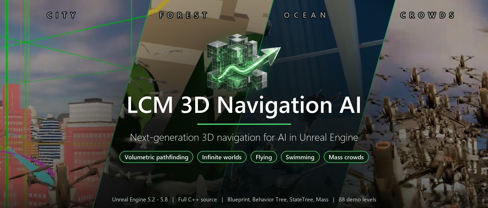
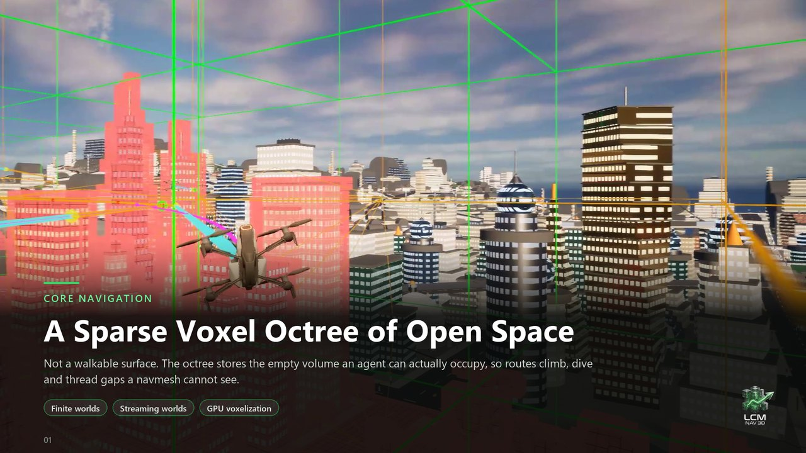
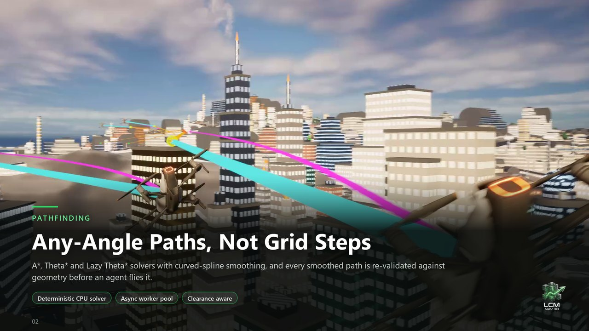
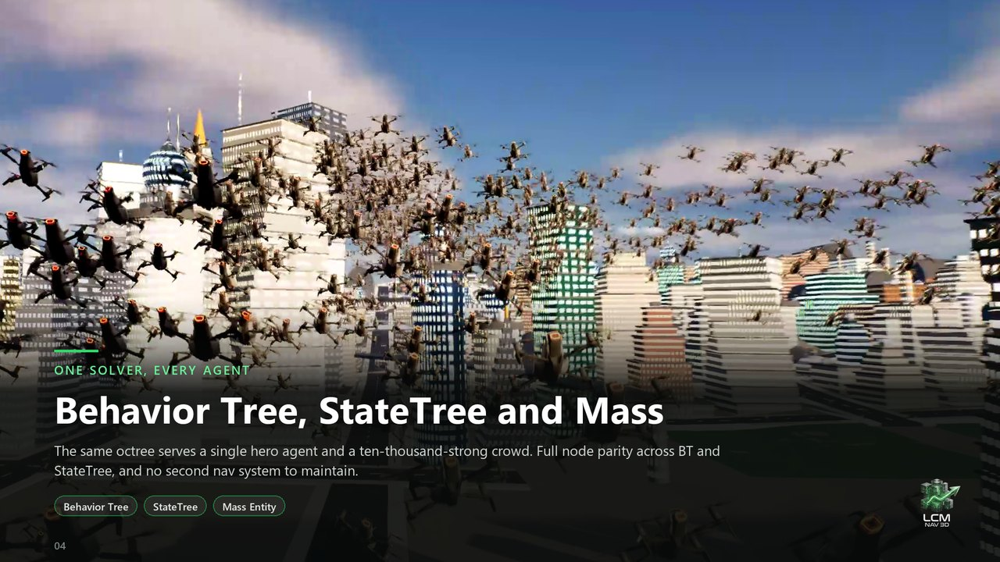
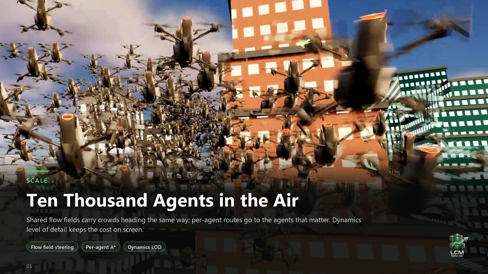
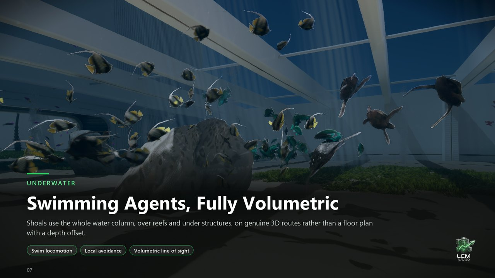
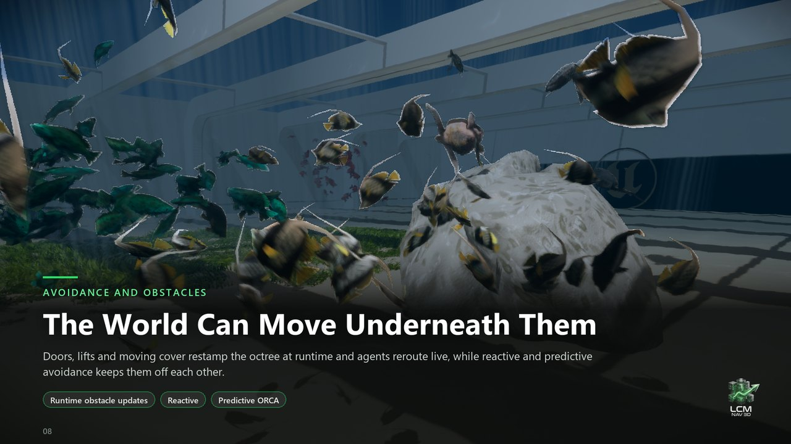
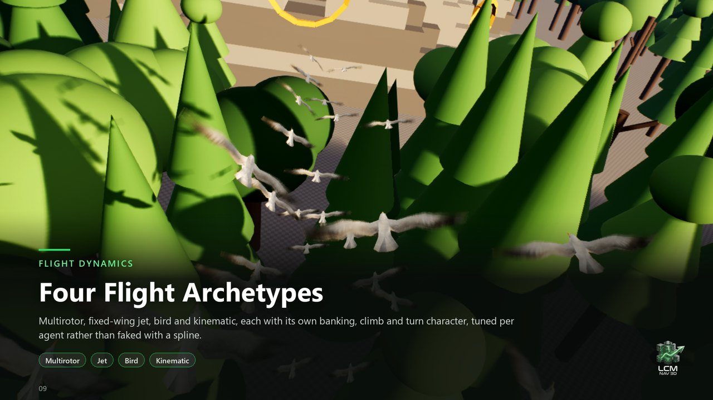

  

<h1 align="center">LCM 3D Navigation AI</h1>

  <b>Next-generation 3D navigation for AI in Unreal Engine 5.</b> 
  True volumetric pathfinding for flying, swimming and free-floating agents - in finite levels and in infinite, streaming worlds.

  
  
  
  
  

  <a href="https://www.fab.com/listings/92f05e42-d7be-4de3-abe8-7b0a3e70ba73"><b>Get it on Fab</b></a> &nbsp;&middot;&nbsp;
  <a href="https://www.youtube.com/watch?v=7_F3AvgQIQU"><b>Watch the trailer</b></a> &nbsp;&middot;&nbsp;
  <a href="https://uedevlabs.itch.io/lcm-3d-navigation"><b>Play the free demo</b></a> &nbsp;&middot;&nbsp;
  <a href="https://lcmnav3d.github.io/"><b>Documentation</b></a> &nbsp;&middot;&nbsp;
  <a href="https://discord.gg/nXkpD6uaBG"><b>Discord</b></a>

---

## Navigation for everything that leaves the ground

Unreal Engine's navigation mesh is a map of floors. It is superb for characters that walk - and it has nothing to say
to a drone weaving between skyscrapers, a flock of gulls over a cliff, a school of fish in a reef, or a fighter in an
asteroid field.

**LCM 3D Navigation AI** navigates the volume itself. It builds a **sparse voxel octree (SVO) of open space** - the
empty air or water an agent can actually occupy - and plans **any-angle 3D paths** through it, so agents climb, dive
and thread gaps that a navmesh cannot see. The same navigation runs a single hero agent or a crowd of more than ten
thousand, and it keeps working in **infinite, streaming worlds** where the map has no edge.

This repository hosts the **free demo levels** for LCM 3D Navigation AI: 88 playable levels and all their art,
installed from inside the Unreal Editor in one click.

## Watch it

  
   The showcase trailer on YouTube. Want to fly it yourself first? <a href="https://uedevlabs.itch.io/lcm-3d-navigation">Play the free demo</a>.

## Features

<table>
  <tr>
    <td width="50%"></td>
    <td width="50%"></td>
  </tr>
  <tr>
    <td></td>
    <td></td>
  </tr>
  <tr>
    <td></td>
    <td></td>
  </tr>
  <tr>
    <td></td>
    <td valign="top">

### What you get

- **Volumetric pathfinding** - a sparse voxel octree of open space, A\*, Theta\* and Lazy Theta\* solvers, any-angle
  paths with curved-spline smoothing that is re-validated against geometry before an agent flies it. Clearance-aware,
  with per-agent size and per-agent cost areas.
- **Infinite navigation** - chunks build around your agents as they travel, cross-chunk portals and a persistent
  long-range graph keep planning through space that has not streamed in yet, and pre-baked octrees load instantly.
- **Every AI framework** - Behavior Tree and StateTree tasks with full parity, Mass Entity crowds, stock
  **Move To** and true-3D **EQS** generators and tests, all exposed to Blueprint.
- **Movement that looks real** - 6-DOF flight and swim locomotion with four flight archetypes: multirotor,
  fixed-wing jet, bird and kinematic.

</td>
  </tr>
</table>

| | |
|---|---|
| **Crowds at scale** | Shared flow fields steer crowds heading the same way, per-agent routes go to the agents that matter, and dynamics level of detail keeps the cost on screen - 10,000+ agent Mass crowds. |
| **Dynamic worlds** | Doors, lifts and moving cover restamp the octree at runtime and agents reroute live; reactive and predictive (ORCA) avoidance keeps them off each other. |
| **Fast to build** | GPU voxelization on DirectX 12, DirectX 11 and Vulkan, with a CPU path for dedicated servers and machines without a GPU. Deterministic CPU path solver on an async worker pool. |
| **Works with Unreal's navmesh** | Walkers stay on Recast, flyers use LCM - in the same level. Navigation links and area modifiers, perception integration and tactical queries in 3D. |
| **Multiplayer** | Server-authoritative navigation with replication. |
| **Tooling** | Live octree, chunk and path visualisation, Gameplay Debugger integration, a setup wizard, a one-click health check that tells you what is wrong, and an editor tuner. |
| **Source and engines** | Complete C++ source, Unreal Engine 5.2 to 5.8, 15 step-by-step tutorials and a full manual. |

## The demo levels

**88 playable levels**, each showing a feature at work - most of them in **Behavior Tree, StateTree and Mass
Entity** editions side by side, so you can compare the three ways of driving the same agents.

| Collection | What it shows |
|---|---|
| **QuickStart** | Ships inside the plugin - no download. A first flying agent, agent size, a patrol and paths queried from Blueprint, each with live pass/fail checks. |
| **Feature Examples** (8 levels) | Navigation basics, flight locomotion, movement nodes, behaviour nodes, tactical queries, cost areas, dynamic worlds and Mass crowds - interactive displays that run each feature and check it while you watch. |
| **Scenario demos** | **Hunter Drone** (a pack hunting a runner through a yard), **Harbour**, **Cliffs** (gull colonies), **Reef** (fish schools), **Warehouse** (security drones) and **Sentry** (drones guarding a perimeter). |
| **Infinite worlds** | City, forest and space open worlds, a **space dogfight**, caves, a vertical skyscraper, Manhattan-style streets and mixed indoor-outdoor routes - streamed around the agents with no edge. |
| **Pre-baked worlds** | The same scenarios with baked navigation that loads instantly, plus a centimetre-scale **fish tank** and the navigation-cost showcase. |
| **Dynamic obstacles** | Moving walls and tunnels that agents reroute around in real time. |

## Get the demo levels

1. Get **[LCM 3D Navigation AI on Fab](https://www.fab.com/listings/92f05e42-d7be-4de3-abe8-7b0a3e70ba73)** and enable it in your project.
2. A project without a startup map of its own opens the **QuickStart** level - LCM 3D Navigation AI at work, nothing else needed.
3. **LCM Nav3D menu > Demo Levels > Download and Install.** The editor downloads the latest release from this
   repository (about 0.9 GB), checks every file, installs it into `Plugins/LCMNav3DSamples` and asks for a restart.
   The demo menu then opens every level. Updates and removal are in the same window.

> The release files are encrypted and install only through LCM 3D Navigation AI; downloading them by hand gives
> nothing usable.

## Requirements

- **Unreal Engine 5.2, 5.3, 5.4, 5.5, 5.6, 5.7 or 5.8**, Windows 64-bit.
- LCM 3D Navigation AI from [Fab](https://www.fab.com/listings/92f05e42-d7be-4de3-abe8-7b0a3e70ba73).
- For GPU voxelization: a DirectX 12, DirectX 11 or Vulkan GPU (the CPU builds navigation where there is none).
- About 1.3 GB of disk space for the demo levels.

## FAQ

**Does it replace Unreal's navigation mesh?**
No - it works alongside it. Ground characters keep using Recast; flying, swimming and free-floating agents use LCM
3D Navigation AI. Stock **Move To** and **EQS** can route through LCM, so existing AI logic keeps working.

**Can I use it from Blueprints only?**
Yes. Its tasks, nodes and settings are exposed to Blueprint, Behavior Tree and StateTree; the complete C++ source is
there when you want it.

**Does it handle huge or endless worlds?**
Yes. Finite levels use one octree; streamed worlds build navigation in chunks around the agents and plan long routes
across chunks that have not loaded yet.

**How many agents can it run?**
Mass Entity crowds of more than ten thousand agents, with flow-field steering and dynamics level of detail.

**Is there documentation?**
A full manual, 15 tutorials and an API reference at **[lcmnav3d.github.io](https://lcmnav3d.github.io/)**, also
shipped inside the plugin. Questions are welcome on **[Discord](https://discord.gg/nXkpD6uaBG)**.

## Links

- **Fab:** [LCM 3D Navigation AI](https://www.fab.com/listings/92f05e42-d7be-4de3-abe8-7b0a3e70ba73)
- **Free demo:** [uedevlabs.itch.io/lcm-3d-navigation](https://uedevlabs.itch.io/lcm-3d-navigation)
- **Trailer:** [YouTube](https://www.youtube.com/watch?v=7_F3AvgQIQU)
- **Documentation:** [lcmnav3d.github.io](https://lcmnav3d.github.io/)
- **Community:** [Discord](https://discord.gg/nXkpD6uaBG)
- **Developer:** [UEDEVLabs](https://uedevlabs.github.io/)

## License

The demo levels are for LCM 3D Navigation AI licensees, for use with LCM 3D Navigation AI, under its EULA. See
[LICENSE](LICENSE).

LCM 3D Navigation AI - volumetric 3D navigation, flying AI pathfinding, infinite world navigation and Mass crowds for Unreal Engine 5.

